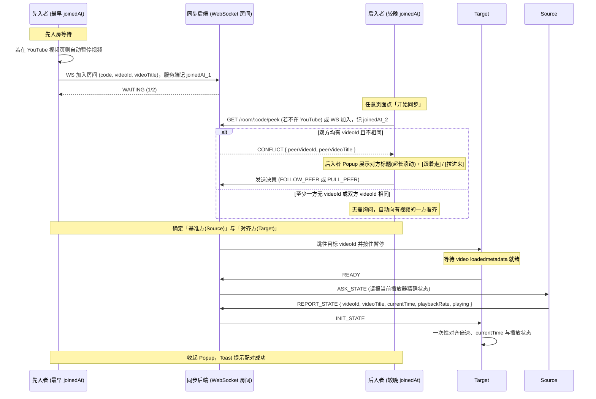

# YouTube 双人同步插件 · 设计与开发文档

> 本文档按项目设计讨论顺序整理，作为后续开发、联调与迭代的权威参考文档（兼顾人类阅读与 AI 编码上下文）。

## 开发进度总览

| 阶段 | 内容 | 状态 |
| :--- | :--- | :--- |
| 阶段 1 | 产品需求与范围确认（v1.0 MVP） | ✅ 已定稿 |
| 阶段 2 | UI 视觉风格与交互逻辑设计 | ✅ 已定稿 |
| 阶段 3.1 | 可扩展分层架构与「配对 + 首次同步」流程 | ✅ 已定稿 |
| 阶段 3.2 | 连接后的实时双向控制与防坑机制 | ✅ 已定稿 |
| 阶段 4 | 后端接口细节、服务器选型与部署配置 | ✅ 已定稿 |
| 阶段 5 | 编码实现、本地联调与手机实机测试 | ⏳ 待开始 |

---

## 一、产品需求（v1.0 MVP）

### 1.1 产品定位
专为双人异地一起看 YouTube 设计的轻量级浏览器插件：**各端直连 YouTube 拉取原生视频流，画质完全无损**，插件仅同步控制指令与播放状态。

### 1.2 运行环境
* **目标网站**：仅适配 YouTube 原站（同时匹配桌面端 `www.youtube.com` 与移动端 `m.youtube.com`）。
* **浏览器生态**：统一按 Chrome Manifest V3 规范开发，覆盖 PC 端 Chrome / Edge 与 Android 端基于 Chromium 且支持扩展的浏览器（如狐猴、Kiwi、Edge Canary 等）。暂不考虑 Firefox / Safari / iOS 等多生态。

### 1.3 连接与配对规则
* **严格双人模式**：同一个配对码同一时间最多允许 2 人在线；若房间已有 2 人，第 3 个连接直接拒绝并提示“房间已满”。
* **出厂默认配对码**：内置默认配对码（如 `YT-8899`），安装后双方不改配置即可直接点击连接配对。
* **自定义与随机换码**：支持手动编辑配对码或点击随机生成新码，修改后持久化保存在本地；后端识别配对码相同即完成配对。
* **手动启停**：平时浏览 YouTube 默认不连接；需要一起看时手动在插件弹窗中点击启动连接，或手动点击断开。
* **单标签页绑定**：仅参与同步的那一个标签页受控，用户另开标签页逛首页或查资料互不干扰；同时禁止同一浏览器打开两个同步标签页。

### 1.4 核心同步功能（强制同步、两端对等、不弹窗询问）
* **入场对齐与后入者决策**：
  * 一方无具体视频时，自动跳去有视频一方并对齐进度。
  * 双方各自开着**不同** YouTube 视频时，由**后入房者**（按服务端 `joinedAt` 时间戳判定）在 Popup 中选择「跟着走」还是「拉进来」。
* **播放 / 暂停**：任意一端播放或暂停，另一端直接强制同步。
* **进度条 / 快进回看**：任意一端拖动进度条或快进/回退，另一端直接强制跳转；正常播放时后台保持进度对齐。
* **播放倍速**：任意一端切换倍速（如 `1.25x`、`1.5x`、`2x`），另一端同步切换。
* **切集直接跟切（方案 A）**：任意一端在同步标签页切换新视频时（含点推荐视频、顶部搜索、地址栏粘贴新链接回车跳转），另一端直接自动跳往新视频；若一方退回 YouTube 首页/搜索页选片，另一方停留在原地等待，直到对方点开具体视频后再跟随切换。
* **画质各自独立**：不同步画质选项，由各方根据自身设备与网速自适应原站画质。

### 1.5 基础体验与容错要求
* **角落轻提示**：对方触发操作或状态变化时，在视频角落闪现简短 Toast，不遮挡字幕与进度条。
* **对方突然关页断开的兜底**：对端直接关闭同步标签页时，本端自动暂停视频，并在页内弹出提示卡片供选择「继续等待」或「断开退出」。
* **广告状态隔离**：一方插播广告期间，暂停向对方发送广告进度/状态，并给予对方提示，广告结束后自动对齐回正片。
* **手机端自动播放兜底**：手机浏览器拦截脚本调用 `video.play()` 时，页面弹出显眼的居中解锁按钮，用户轻点一下即可恢复同步播放。
* **断线重连**：网络波动或手机短切后台恢复后自动重连并对齐状态。

### 1.6 本期暂不做（控制复杂度，但架构预留扩展性）
* 多人同步（>2 人）及房主权限锁。
* 临时“暂停同步”开关（后续仅需在同步引擎增加布尔开关即可快速扩展）。
* 聊天室、弹幕、语音连麦、用户账号注册/登录体系。
* 非 YouTube 视频网站与 iOS 端适配。

---

## 二、UI 与交互设计

### 2.1 Popup 弹窗（总控入口）
采用 **方案一：YouTube 原生暗夜风（Native Dark）**，宽 `248px`，与 YouTube 深色主题融为一体。平时严格精简为 **2 个核心元素**（1 个密钥栏 + 1 个主按钮），并在特殊状态下给出清晰分流。

#### Popup 全状态矩阵（6 种常规态 + 1 种入房视频冲突双选态）

| # | 状态场景 | 当前在同步页吗？ | 密钥栏状态 | 底部按钮区（方案一暗夜风） | 点击效果 |
| :--- | :--- | :---: | :--- | :--- | :--- |
| **1** | **未连接（空闲）** | 任意页 | 可编辑 + `随机` `复制` | 红胶囊单按钮：`▶ 开始同步` | 发起配对连接 |
| **2** | **等待对方** | 是 | 锁定只读 + `复制` | 琥珀单按钮：`● 等待对方加入…` *(悬停变 `取消等待`)* | 断开，回到状态 1 |
| **3** | **已同步** | 是 | 锁定只读 + `复制` | 翡翠绿单按钮：`● 已同步 · XXms` *(悬停变 `断开连接`)* | 断开，回到状态 1 |
| **4** | **跨页查看**（同步页仍开着，但在其他页点 Popup） | **否** | 锁定只读 + `复制` | **左右双胶囊**：`[ ↗ 回到同步页 ]` `[ 断开 ]` | 左：切回同步页<br>右：断开原连接，回到状态 1 |
| **5** | **断线重连中** | 是 | 锁定只读 + `复制` | 橙红脉冲单按钮：`● 重连中…` *(悬停变 `放弃重连`)* | 放弃重连，回到状态 1 |
| **6** | **房间已满 / 连接失败** | 任意页 | **解锁可编辑** + `随机` `复制` | 红描边单按钮：`! 房间已满 · 重试` | 换码或直接点重试 |
| **7** | **入房视频冲突双选态**（仅后入者遇到不同视频时） | 是 | 锁定只读 + `复制` | **左右双胶囊**：`[ 跟着走 ]` `[ 拉进来 ]` | 选定基准视频并立刻触发首次同步 |

* **长标题跑马灯滚动显示**：插件捕获当前 YouTube 页面标题（`videoTitle`）并随 `videoId` 一同上报服务器；当 Popup 展示对方正在观看的视频名称（如冲突双选态的 `对方正在看《...》`）且标题长度超出弹窗宽度时，采用**平滑横向跑马灯滚动（Marquee）**展示完整标题，避免截断看不清。
* **自动收起**：双人配对并完成首次状态对齐后，Popup 自动调用 `window.close()` 收起（如仍处于打开状态）。

### 2.2 YouTube 页内注入 UI（Shadow DOM 隔离）
为了同时兼容桌面 Chrome 与 Android 浏览器（手机端不支持 `sidePanel`），页面内不设常驻控制面板，仅通过 Shadow DOM 在同步标签页注入轻量提示层：
* **右上角轻提示（Toast）**：对方操作时闪现 `1.5 ~ 2s` 后淡出（如 `对方暂停了`、`对方调至 1.5x`、`已跟随切集`）。
* **异常持续小徽标**：仅在特殊状态出现、恢复即消失（如 `对方正在看广告…`、`对方正在选片…`、`断线重连中…`）。
* **对方突然关页断开的页内提示框**：
  * 因 Chrome MV3 禁止在无用户点击的情况下自动弹出右上角 Popup，当对端直接关闭标签页导致断开时，本端先**自动暂停视频**，并在播放器上层通过 Shadow DOM 弹出暗夜风提示卡片：`对方已断开连接，视频已暂停`，附带两个按钮 `[ 继续等待 ]` 和 `[ 断开退出 ]`。
* **手机端自动播放解锁层**：仅当 `video.play()` 被浏览器拦截抛出 `NotAllowedError` 时，在播放器中央显示半透明胶囊按钮 `▶ 点击屏幕同步播放`，点击后立刻播放并追齐进度。

### 2.3 浏览器安全边界说明
* 现代浏览器强制规定全屏 API（`requestFullscreen`）必须由**用户本人当次真实点击/触屏事件**同步触发，禁止通过收到远端 WebSocket 消息自动进入全屏。因此配对成功后不强制自动全屏，由用户自行按需全屏。

---

## 三、可扩展分层架构规划

MVP 代码保持轻量（纯原生 JS/CSS，零重型构建框架依赖），同时做好 4 层职责边界，方便未来扩展多网站、临时暂停同步或换用不同后端服务：

```text
extension/
├── manifest.json                 # Chrome MV3 配置（匹配 www.youtube.com & m.youtube.com）
├── background/
│   └── service-worker.js         # 【调度层】无状态调度：维护 activeTabId、监听关闭/跳转续连、非 YouTube 页查房开页
├── popup/
│   ├── popup.html                # 【视图层】方案一暗夜风结构（6 常规态 + 1 冲突双选态）
│   ├── popup.css
│   └── popup.js                  # 读写配对码与触发连接/断开/冲突决策指令
└── content/
    ├── main.js                   # 【装配入口】绑定单标签页同步生命周期，串联各层
    ├── adapters/
    │   └── youtube.js            # 【站点适配层】唯一接触 YouTube DOM / SPA 路由 / 广告检测
    ├── sync/
    │   └── engine.js             # 【同步引擎层】纯状态机与同步算法，与具体网站解耦
    ├── transport/
    │   └── ws-client.js          # 【通信传输层】WebSocket 收发、心跳测 RTT、断线重连
    └── ui/
        └── overlay.js            # 【页内提示层】Shadow DOM Toast、徽标、断线提示卡与手机解锁按钮
```

**关键架构决策：**
1. **规避 MV3 Service Worker 休眠**：Manifest V3 后台脚本闲置约 30 秒会被系统回收，因此 **WebSocket 长连接直接由当前绑定同步的 YouTube 标签页（`content/main.js`）维护**；关闭该标签页时底层 WS 连接立即断掉。
2. **后台跨刷新保活与清理**：`service-worker.js` 仅在 `chrome.storage.session` / `local` 持久化当前同步的 `activeTabId` 与 `pairingCode`：
   * 监听 `chrome.tabs.onRemoved`：若同步标签页被关闭，后台立刻清空本地连接态并复位为「未连接」。
   * 在同步标签页内直接在地址栏粘贴新 YouTube 链接或顶部搜索整页刷新时，`tabId` 保持不变；新注入的脚本启动后询问后台确认仍为同步页，随即自动续连并向对方同步新 `videoId`。
3. **站点适配解耦 & 房间兼容扩展**：新增站点只需在 `adapters/` 增加适配器；后端房间仅设人数上限常量（默认 `MAX_PEERS = 2`），未来扩展成本极低。

---

## 四、核心流程 1：配对与首次同步（已定稿）

采用 **「对称房间 + 服务端时间戳判定先后 + 后入者视频冲突决策 + 就绪后现问现答对齐」** 策略。系统不设固定“房主/访客”身份，完全由服务端为每个连接记录的入房时间戳 `joinedAt` 判定「先入者」与「后入者」。



### 4.1 入房时的 3 种视频判定分支
1. **双方均无视频，或 `videoId` 相同**：直接配对成功；若一方刚打开了同一视频，由后入者就绪后问先入者对齐进度。
2. **仅一方有 `videoId`（另一方在普通网页或 YouTube 首页）**：无需弹窗询问，无视频的一方自动新开/跳转到有视频的一方，加载就绪后发 `READY` 对齐（避免出现“把正在看片的人拉去空白网页”的无效选项）。
3. **双方各自开着不同的 YouTube 视频**：服务端对比 `joinedAt`，仅向**后入者**下发冲突事件，Popup 底部切为 `[ 跟着走 ]` `[ 拉进来 ]`：
   * 点 **「跟着走」**：后入者跳往先入者的视频，先入者为基准方，后入者对齐进度。
   * 点 **「拉进来」**：先入者自动跳往后入者的视频，后入者为基准方，先入者加载就绪后对齐进度。

### 4.2 关键数据字段说明
* `joinedAt`：服务端记录成员成功连入房间的毫秒时间戳，仅用于判定当次配对谁先谁后，任意一方断开重连即重新计时。
* `videoTitle`：插件从当前 YouTube 页面捕获的视频标题，随 `videoId` 一同上报服务器，用于向连接中的另一方展示正在观看的视频名称（超长时滚动显示）。
* `currentTime`：播放器当前的播放位置，单位为**秒**（例如 `125.4` 表示 `02:05.4`），直接对应 HTML5 `<video>.currentTime`。
* `serverTime`：服务器处理同步包时的毫秒级时间戳（例如 `1732260000000`），用于实时同步阶段配合 RTT 抵消网络传输延迟。

---

## 五、核心流程 2：连接后的实时双向控制与防坑机制（已定稿）

### 5.1 单标签页约束与关页自动清理
* **单页锁定**：后台仅保存一个 `activeTabId`。若在非同步标签页打开 Popup，仅提供 `[ ↗ 回到同步页 ]` 与 `[ 断开 ]`，禁止多开。
* **关闭即断**：直接关闭同步标签页时，该页的 WebSocket 连接随进程销毁立即断开，服务器 1 秒内通知对端（对端自动暂停并弹出 `继续等待 / 断开退出` 页内卡片）；同时本端后台监听 `chrome.tabs.onRemoved` 清理 `activeTabId`，使本端用户可随时在任意新标签页直接重新点击「开始同步」。

### 5.2 实时同步数据结构
进入同步状态后，任意一方触发操作时，发送全量控制包 `CONTROL`（每次同时携带完整三态，抗偶发丢包）：

```json
{
  "type": "CONTROL",
  "action": "seek",          // 5 种动作：play | pause | seek | rate | video_change
  "videoId": "dQw4w9WgXcQ",  // 当前视频 ID（两端不一致时拒绝应用进度/播放指令）
  "videoTitle": "Never Gonna Give You Up", // 视频标题（用于切集提示与超长滚动展示）
  "currentTime": 125.4,      // 操作瞬间视频播到第几秒
  "playbackRate": 1.25,      // 操作瞬间的倍速
  "playing": true,           // 操作瞬间是播放还是暂停
  "version": 15              // 每次操作由服务器递增 +1（防止弱网下旧包后到覆盖新状态）
}
```

辅助消息：
* **状态提示 `STATUS`**（不改播放状态，只控制对端右上角小徽标）：
  ```json
  { "type": "STATUS", "status": "ad_start" }  // ad_start | ad_end | browsing_home
  ```
* **心跳测速 `PING` / `PONG`**（每 5 秒发送一次，用于保活、测算单程延迟并同步存至服务端）：
  ```json
  { "type": "PING", "t": 1732260005000, "delay": 0.03 } // 服务端原样回传 t，并将客户端上报的平滑单程 delay 存入连接附件
  ```

### 5.3 抗延迟与防死循环核心机制
> 不使用两台设备的系统时间直接相减（避免双方本地时钟不准导致大偏移）。

1. **两段延迟精确相加（`totalDelay = delayA + delayB`）**
   * 客户端每 5 秒发送 `PING`、服务端秒回 `PONG`，客户端利用自身同一块本地时钟算出往返延迟 `rtt` 与单程延迟 `delay = (rtt / 2) / 1000` 秒（做平滑滤波，同时随包上报服务端存进该连接的 Attachment）。
   * 服务端（Single-Threaded Event Loop，天然按队列顺序处理，无并发脏读）转发 `CONTROL` 包时，直接附带双方两段延迟之和 `totalDelay = delayA + delayB`。
   * 接收方收到 `playing: true` 控制包时，计算完整补偿后的目标位置：`targetTime = currentTime + totalDelay * playbackRate`；若 `playing: false`（暂停态），直接精确设到 `currentTime`，不做推进。
2. **三段式无感追帧（防频繁硬跳导致缓冲转圈）**
   * 误差 `< 0.4s`：肉眼几乎无感知，忽略不动。
   * 误差 `0.4s ~ 2.0s`：不触发 `seek`，临时将本地播放倍速在基准倍速上微调 `±5%`（如落后时临时 `1.05x`），平滑追平后立即恢复原倍速。
   * 误差 `> 2.0s`：直接执行 `video.currentTime = targetTime` 硬跳对齐。
3. **消费即释放的状态锁（Echo Guard）+ 400ms 超时兜底（TTL）与防抖**
   * 插件修改 `<video>` 前，在本地状态锁上标记预期事件（如“即将执行一次 `pause`”）；大约 `5~20ms` 后浏览器触发监听回调时，监控命中该标记后**立即核销释放锁并忽略该次事件**（不向外发），随即恢复正常监听用户操作。
   * 附加 **`400ms` 超时自动释放（TTL）**：防止因“手机端自动播放被拦截未触发 `play` 事件”或“视频本就处于目标状态未触发事件”而导致锁永远挂死。
   * 本地拖动进度条加 `200ms` 防抖（Debounce），避免拖拽过程中连续发送无效中间位置。
4. **广告状态隔离**
   * 适配器检测播放器容器的 `.ad-showing` 类名：任意一方处于广告中时发送 `ad_start`，期间挂起双端进度同步（避免广告 `0:05` 覆盖对方正片进度）；播完发送 `ad_end`，立刻按对端当前正片状态重新对齐。

---

## 六、后端接口细节、服务器选型与部署配置（已定稿）

### 6.1 服务器选型与免费额度评估
* **选型**：**Cloudflare Workers + SQLite-backed Durable Objects（Free Plan）**。
* **免费额度**：每日 `100,000` 次请求（北京时间每日 08:00 重置，超额不扣费），每日 `13,000 GB-seconds` 计算时长；WebSocket 入站消息按 **20 : 1** 折算计次，出站消息完全免费；自带免费 `https://` 与 `wss://*.workers.dev` 域名。
* **Hibernation 休眠保活优化**：房间实例采用 **WebSocket Hibernation API**（`ctx.acceptWebSocket(ws)` + `ws.serializeAttachment()`），两人观影不操作时 Durable Object 自动休眠、**不扣计算时长**，来消息瞬间唤醒转发。
* **实际用量估算**：双人看一部 3 小时电影（每 5 秒心跳 + 操作），总计约 `4,500` 条入站消息，折算仅约 **`226` 次请求**（占日额度 **`0.23%`**）与不到 **`0.5%`** 计算时长，日常使用零成本、无触顶风险。

### 6.2 后端目录结构与接口规范

```text
server/
├── wrangler.toml      # Cloudflare 部署配置（声明 Durable Object 与 SQLite 免费迁移）
└── src/
    └── index.js       # Worker 路由入口 + SyncRoom 房间类（单线程处理、零并发锁冲突）
```

* **`GET /room/:code/peek`**（轻量 HTTP 预查）
  * 供在非 YouTube 页面点击「开始同步」时预检房间状态，返回 `{ full: boolean, peerCount: number, videoId: string | null, videoTitle: string | null }`。
* **`WSS /room/:code/ws`**（双人实时 WebSocket 通道）
  * 配对码映射独立房间实例，人数上限常量 `MAX_PEERS = 2`，第 3 人接入时直接以关闭码 `4001` 拒绝并提示房间已满。

### 6.3 部署与插件分发流程
1. **服务端上线**：`npx wrangler login`（授权 Cloudflare 账号）→ `npx wrangler dev`（本地 `ws://localhost:8787` 联调）→ `npx wrangler deploy`（一键上线获取 `wss://*.workers.dev` 域名）。
2. **插件端分发（免商店审核与开发者费用）**：
   * **PC 端（Chrome / Edge）**：打开 `chrome://extensions` → 开启开发者模式 → 加载已解压的 `extension/` 文件夹。
   * **Android 端（狐猴 / Kiwi / Mises 等 Chromium 浏览器）**：将 `extension/` 打包为 `.zip`，在浏览器扩展管理页选择从 `.zip` 导入。

---

## 七、待补充章节

### 7.1 编码实现与联调测试
> *⏳ 待开始：Cloudflare 测试连通验证、后端与插件代码编写、PC 双窗口联调、PC + Android Chromium 浏览器实机测试。*
