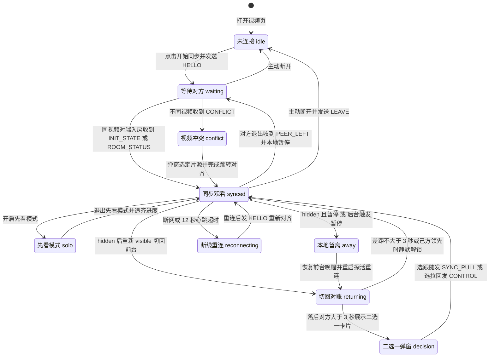
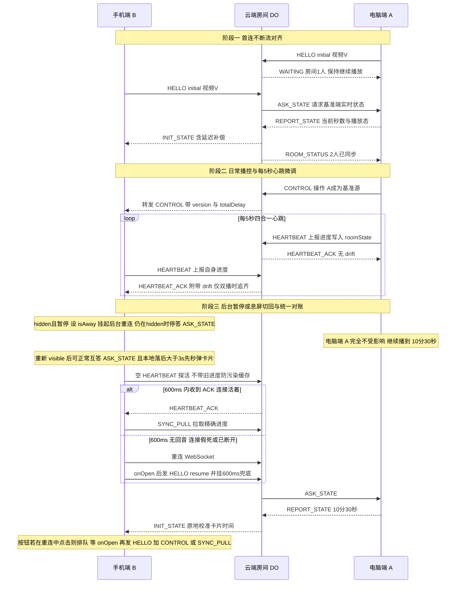

# YouTube 同步看 (`yt-sync`)

一款专为异地双人 / 小群共同观影设计的 Chrome Manifest V3 浏览器扩展与 Cloudflare Durable Objects 同步服务端：双方各自直接加载视频平台原生高清流（零转码、零推流、原画质无损），插件仅通过轻量 WebSocket 实时同步播放、暂停、拖拽、倍速与切集控制信令。

---

## 🤖 给 AI 助手的一键部署提示词（新手直接复制）

> 如果你不熟悉 Cloudflare 或命令行，只需把本仓库打开在你的 AI 编程工具中（如 Antigravity、Cursor、Claude Code、Windsurf、GitHub Copilot 等），直接复制下方整段提示词发给 AI，让它一步步带你完成注册与部署：

````markdown
请协助我从零完成当前项目（`yt-sync`）的 Cloudflare 后端部署与浏览器扩展打包安装。请一步一步引导我操作，每一步先检查我的本机环境或等我确认后再继续：

1. **引导注册与开通 Cloudflare 免费账号**
   - 指导我打开 https://dash.cloudflare.com/sign-up 注册免费账号并完成邮箱验证；
   - 说明本项目使用 Cloudflare Workers Free Plan + Durable Objects SQLite 免费额度即可运行（个人/好友同步观影无需绑定信用卡付费升级）；
   - 提醒我记住首次部署时在 Cloudflare 控制台或命令行选择的 `*.workers.dev` 个人子域名。

2. **检查并准备本地 Node.js 环境**
   - 检查本机 `node -v`（建议 v20+）与 `npm -v`；如果未安装，指导我在当前系统安装 Node.js LTS。

3. **登录 Wrangler 并部署信令服务端**
   - 进入 `server/` 目录执行 `npx wrangler login`（指引我在弹出的浏览器页点击 Authorize 登录）；
   - 执行 `npx wrangler deploy` 部署 Durable Object `SyncRoom`，从终端输出提取我真实的 `https://yt-sync.<我的子域名>.workers.dev` 地址。

4. **运行线上全链路自检**
   - 使用上一步拿到的真实域名执行：`YT_SYNC_HOST="yt-sync.<我的子域名>.workers.dev" node server/test_live.mjs`，确认全部测试通过。

5. **配置本地扩展并打包安装**
   - 把我真实的 Worker 域名写入本地以下 3 个文件（替换占位符 `yt-sync.your-subdomain.workers.dev`）：
     1. `extension/manifest.json`（`host_permissions`）
     2. `extension/content/config.js`（`SERVER_HTTP` 与 `SERVER_WS`）
     3. `extension/background/service-worker.js`（`SERVER_HTTP`）
   - 将 `extension/` 目录**内部文件直接打包**为根目录就是 `manifest.json` 的 `yt-sync-extension.zip`（确保不含外层套壳目录）；
   - 指导我在电脑端 Chrome / Edge 通过「开发者模式 -> 加载已解压的扩展程序（选择 `extension/`）」安装，以及在手机端支持扩展的 Chromium 浏览器（如 Kiwi / Edge / 狐猴浏览器）导入 `yt-sync-extension.zip` 安装。

6. **安全红线**
   - 严禁把我私有的 `*.workers.dev` 真实域名或 Cloudflare `account_id` 提交推送到公开 Git 仓库；如果后续需要提交代码，必须先恢复为占位符 `yt-sync.your-subdomain.workers.dev`。
````

---

## ⚠️ 平台支持现状

| 平台 | 状态 | 说明 |
| :--- | :---: | :--- |
| **YouTube**（桌面端 `www.youtube.com` / 移动端 `m.youtube.com`） | **✅ 完整可用** | 完整支持播放控制、SPA 切集、广告避让、搜索选片提醒、后台听音及移动端弹窗解锁 |
| **哔哩哔哩（B站）**（`www.bilibili.com` 桌面版 & 手机「桌面版网站」模式） | **✅ 完整可用** | 支持桌面端与手机浏览器开「桌面版网站」同步看片；检测到触屏设备（`pointer: coarse`）时自动接管为 B 站 App 风格触控播放器（单击播/停、长按 `2.0x`、大热区拖进度、原生 `videoshot` + `pvdata` 切片缩略图预览、右屏手势/32px 极简音量条、右滑倍速抽屉、弹幕开关与「原栏 / ✨ 触屏栏」随时切换），真实 PC 鼠标端完全不受影响 |

### 💡 已知限制与使用建议（重要）

- **📱 手机端看 B 站建议手动切换为 AVC（H.264）解码**：
  - 本扩展触屏控制栏目前暂未内置视频编码/解码器切换选项；部分手机浏览器在 B 站桌面模式下默认加载 HEVC / AV1 流时，可能出现加载慢、拖进度卡顿甚至黑屏；
  - 建议首次使用时点击画面右上角「**原栏**」切回 B 站原生控制栏 → 打开右下角齿轮「设置」→「更多播放设置」→ 将播放策略/编码选为 **AVC（H.264）**（浏览器会记忆此偏好）→ 再点击「**✨ 触屏栏**」切回触屏模式，手机端流畅度会明显提升。
- **🔊 网页内调音仅能控制“系统当前音量的百分比”**：
  - 受 W3C Web 标准与浏览器安全沙箱限制，网页和 MV3 扩展只能修改 `<video>.volume`（`0% ~ 100%`），实际输出遵循 `当前实际音量 = 手机系统媒体音量 × 网页百分比`，**无法像原生 App 那样直接拉高或控制操作系统硬件音量**（B 站/YouTube 原生网页版同样受此限制）；
  - 建议日常将播放器音量保持在 **`100`**，用手机实体音量键控制总响度，画面右侧上滑或底栏音量条用于网页内微调与一键静音。
- **🧩 低频原生控制项暂需切回「原栏」**：
  - 清晰度、编码方式、分 P 选集、字幕与高阶弹幕屏蔽等低频选项未堆叠进极简触屏栏，需要调整时点右上角「**原栏**」即可调出完整原生控制栏，改完再一键切回「**✨ 触屏栏**」。

---

## ✨ 核心功能

- **原画质对等同步与延迟补偿**
  - 实时同步播放、暂停、拖拽进度（200ms 防抖）、倍速变化与同站点切集；
  - 结合 `HEARTBEAT` 往返时延平滑测算并补偿双跳网络延迟（`发送端单程延迟 + 接收端单程延迟`）；
  - 每 5 秒随心跳附带三档漂移校准（偏差 `< 0.35s` 忽略、`0.35s ~ 1.5s` 按当前基础倍速相对乘算 `±8%` 即 `baseRate × 1.08 / 0.92` 微调追齐、`> 1.5s` 直接跳转对齐），切回前台双播时差距 `1.0s ~ 3.0s` 当场硬跳齐、`0.35s ~ 1.0s` 当场起追；
  - 播/停状态幂等去重 + 跳转目标账本（4 路撕单保护 + 按倍速动态放宽回声容差）+ 无手势微调过滤（拦截 `< 1.8s` 内部切画质/缓冲幽灵 `seeked`，`< 1.2s` 远程微调静默对齐不刷屏）+ 目标值匹配倍速锁（`±0.02` 误差才吞回声，微调期间长按 `2x` 加速永不误吞或误判插件冲突），消除双端操作反弹乒乓与连环提示。
- **片尾连播防连环跳与切集必达**
  - SPA 切集严格屏蔽复用 `<video>` 残留的上部片尾时间与幽灵事件，远程跳转目标时间自动钳位在 `duration - 0.8s` 以内防止直接冲过片尾触发自动连播；
  - `watchNavigation` 过滤同视频 URL 参数变化并可随时取消旧兜底跳转定时器；`CONTROL(video_change)` 绕过回归锁直接清卡并按 `version` 跟随防一方留在原地；切集后 2.5s 内无手势自动连播自动纠偏，整页刷新切集静默挂起 WS 并以 `mode: "resume"` 自动接回。
- **广播房间 + 四合一心跳活跃机制**
  - 取消严苛的 2 人槽位与强制踢人，支持 2 人及小群多设备协同（软上限 16 连接）；
  - 5 秒四合一 `HEARTBEAT` 同时完成测延迟、刷新活跃状态、上报基准快照与捎带下发 `drift` 微调；
  - 同设备凭 `clientId` 自动顶替旧连接；超过 20 秒无心跳自动降为非活跃跳过广播（不踢人、不打断别人），10 分钟无流量自动垃圾回收。
- **统一前后台对齐盾与移动端息屏保护**
  - 第一个人点击同步等待期间保持正常播放（不强制暂停），对方进房后直接拉取实时秒数并对齐；
  - 切去其他标签页或锁屏时若视频处于播放态，支持顺应后台听音与通知栏/锁屏控件**前后双向调节进度**（不依赖节流后的 `timeupdate`，后台在播且连线存活时放行往回拖进度并同步给对方，绝不误暂停或撤掉后台媒体控制器）；
  - 若后台/息屏时处于暂停态，则本地标记暂离、挂起后台自动重连、停发旧时间快照且在页面仍处于 `hidden` 时暂不回复 `ASK_STATE`，防止息屏断连抢跑或污染房间基准时间；
  - 任何页面重新回到前台（`visible`）时，先屏蔽外发并经 **600ms 心跳探活 / 重连**（连通后挂 `600ms` 缓存兜底，遇 `WAITING(2)` 立即解套）并正常互答 `ASK_STATE`，打破双端同时切回时的互等死锁：
    - **自己落后对方 `> 3s`**：弹出居中双铭牌动态计时二选一卡片（**跟随对方最新秒数** / **将大家拉回离开前秒数**），即使还在重连中点按钮也会排队等待连上后自动兑现；
    - **差距 `≤ 3s` 或己方领先**：不弹窗不打断，挂上仅拦截无手势幽灵事件的 `initGuardUntil` 保护期（用户 0ms 真实点击直接放行）后静默恢复或当场对齐；
    - 若对齐期间用户主动点播/按快捷键，右上角立即展示带旋转 `<progress>` 指示器的「正在对齐进度…」胶囊与轻提示，兼顾不丢信令与交互反馈。
- **无感自动续连与误关标签页一键救回**
  - 结合 `window.sessionStorage` 与 `chrome.storage.local`（6 小时 TTL）以及 BFcache `pagehide` / `pageshow` 恢复；手机黑屏、断网或系统回收页面重载后自动认领同步标签页并重连，同时拦截黑屏销毁视频导致的 `00:00` 脏进度污染；
  - **60 秒误关一键重连胶囊**：非主动退出误关同步标签页后保留 60 秒本地记忆，若 60 秒内重开同一视频且经 `/peek` 确认房内仍有同伴，右上角浮出不抢控制的「检测到刚断开的同步房间 · [一键重连]」（15 秒无操作自动收起，主动点击断开则清除记忆不误打扰）。
- **实用观影辅助能力**
  - **纯 Popup「先看模式」**：在弹窗内随时切出同步独立快进看，退出时自动对齐同步成员（支持双人各自先看状态机）；
  - **内置快捷键与倍速插件冲突提醒**：同步中支持 `A`（`-0.1x`）、`D`（`+0.1x`）、`S`（`1.0x`）快捷键调速并右上角提示；若倍速在 600ms 内被 Global Speed 等第三方插件强行改回，自动拦截回传并弹出警告提示（15 秒冷却防刷屏）；
  - **非侵入式搜索选片提醒**：一方在 YouTube 搜索页选片时，另一方右上角浮现可点击胶囊「对方正在搜『关键词』 [一起挑片]」；
  - **YouTube 广告避让 & 移动端解锁**：自动识别 `.ad-showing` 广告并暂挂同步；移动端拦截自动播放时展示一键点击解锁遮罩。
- **哔哩哔哩（B站）全流程同步 & 手机桌面模式原生级触控接管**：
  - 完整适配 `www.bilibili.com` 播放、分 P / 合集 / 番剧切换与片尾防连环跳，自动忽略同视频参数噪音（如 `vd_source`）误触发切集，并屏蔽非可信合成键盘事件防快捷键冲突；
  - 在触屏设备（`pointer: coarse`）以桌面版访问 `www.bilibili.com` 时自动启用 [`bili-touch-player.js`](extension/content/ui/bili-touch-player.js)：提供与 B 站 App 一致的单击即播停、长按 `2.0x` 全局防卡死倍速、窗口/全屏大触控热区、原生 `videoshot` / `pvdata` 二进制索引 + 降采样 `<canvas>` 低内存切片缩略图预览、`1.0s / 2.8s` 原生分层状态栏自动收回、原生 `.bpx-player-container` 全屏复用、片尾推荐点击穿透与「原栏 / ✨ 触屏栏」热切换。
- **三层极简深色 Popup UI & 轻量三端排障导出**
  - 顶部状态与活跃人数 + 分级延迟徽章（`<80ms` / `80~180ms` / `>180ms`），独立配对码框（默认 `YT-8899`，点击全选、随机生成、一键复制），桌面/手机触屏均直观无需悬停猜按钮；任意网页支持一键切回同步标签页或在空白页先 `/peek` 房间并自动新开视频页直达；
  - 弹窗底部提供低调「**导出排障日志 / 清空**」入口：过滤式记录客户端关键操作/拦截原因/3s 切集落点检测 `nav_miss`（400 条本地环形落盘），服务端 `SyncRoom` 在非心跳关键信令落盘保存最近 150 条路由日志（防 DO 休眠丢失，房间清空即删库）；一键导出自动带 6 位 `traceId` 关联并完成域名/房间码/标题/视频 ID 脱敏的三端原始 JSON（兼顾剪贴板兜底）。

---

## 📐 同步架构与核心设计（开发者导读）

整套系统由 **1 条浏览器 ↔ Cloudflare Durable Object 的 WebSocket 长连接** 承载全部控制面信令，媒体流完全走用户本地到视频平台的直连通道。

### 一、三层同步机制

1. **事件驱动即时同步层（`CONTROL`）**：[`engine.js`](extension/content/sync/engine.js) 监听 `<video>` 的 `play`、`pause`、`seeked`、`ratechange` 与 SPA 切集。任意一端产生有效操作，立即发出携带 `action`、时间戳、倍速的 `CONTROL`；服务端 [`index.js`](server/src/index.js) 将操作者设为主视角**基准源（`refPeerId`）**，分配严格递增 `version`，附加双方单程延迟和 `totalDelay` 转发给其余活跃成员。
2. **单基准源房间时钟层（`refPeerId` + `roomState`）**：房间仅认 1 位基准源写入内存快照 `roomState`，避免双端互追引发抖动。基准源按以下 3 条规则确定：首个带视频进房者、最近发送 `CONTROL` 的操作者、或原基准源超过 20 秒无心跳（或离开/`AWAY`）后按活跃优先级自动接管。
3. **5 秒心跳保活与漂移纠偏层（`HEARTBEAT` + `drift`）**：双端每 5 秒发送一次 `HEARTBEAT` 测量 RTT 与探活；服务端仅将**基准源**的非暂离快照写入 `roomState`（`persist: false` 纯内存零落盘），并仅为**非基准源**下发推算后的 `drift`，播放态下按 `<0.35s` 忽略、`0.35~1.5s`（`baseRate × 1.08 / 0.92`）、`>1.5s` 直接 `seek` 三档追齐；切回前台双播时则采用更紧的 `1.0s` 硬跳门槛立即抹平。

### 二、WebSocket 信令数据流速查表

| 阶段 | 客户端 → 服务端 | 服务端 → 客户端 | 用途说明 |
| :--- | :--- | :--- | :--- |
| **进房与重连握手** | `HELLO`（`initial` / `resume`）<br>`CONFLICT_DECISION`<br>`SYNC_PULL` / `READY`<br>`REPORT_STATE` | `WAITING`（房间仅 1 人）<br>`CONFLICT`（片源不一致）<br>`NAVIGATE`（强制或自动跳片）<br>`ASK_STATE`（向基准源取实时进度）<br>`INIT_STATE`（含延迟补偿与 `version`）<br>`ROOM_STATUS` / `SYNC_READY` | 首次对齐片源与秒数；前台回归时查询对方最新状态（`fallbackOnly: true` 仅作兜底直读 `roomState`） |
| **日常播控同步** | `CONTROL`（`play` / `pause` / `seek` / `rate` / `video_change`） | `CONTROL`（附带 `totalDelay` 与单调 `version`） | 毫秒级同步操作并切换 `refPeerId` |
| **心跳保活与纠偏** | `HEARTBEAT`（时间戳 `t`、单程 `delay`、播放快照；暂离时发 `{}` 空包） | `HEARTBEAT_ACK`（回传 `t`、活跃数、`revived`、`drift`） | 测算 RTT、探测半开假死、维持房间活跃、下发漂移校准 |
| **状态与辅助提示** | `LEAVE`<br>`SOLO_ENTER` / `SOLO_EXIT`<br>`STATUS` / `SEARCHING` | `PEER_LEFT`<br>`PEER_STATUS` / `STATUS` / `PEER_SEARCHING`<br>`SOLO_WAITING_PEER` | 退出提示、先看模式、广告避让与搜索选片联动 |
| **三端排障导出** | `DEBUG_DUMP_REQ`<br>`DEBUG_DUMP_DATA` | `DEBUG_DUMP_COLLECT`<br>`DEBUG_DUMP_RES` | 携带 `traceId` 一键拉取对端快照 + 服务端抗休眠路由日志合并导出 |

### 三、客户端状态机



### 四、三阶段核心信令交互时序图



### 五、关键工程小设计（开发者避坑指南）

1. **如何把同步延迟压到无感**
   - **EWMA 平滑单程延迟前向补偿**：[`ws-client.js`](extension/content/transport/ws-client.js) 按 `0.7 × 旧值 + 0.3 × 新采样` 过滤网络毛刺，计算 `delay = RTT / 2`；服务端打包双端延迟之和 `totalDelay`，接收端仅在 `playing === true` 时将目标秒数前推 `currentTime + totalDelay × playbackRate`。
   - **按基础倍速相对微调追齐代替频繁 `seek`**：播放器一旦硬跳就会清空缓冲重拉分片；日常 `< 0.35s` 静默忽略，`0.35s ~ 1.5s` 漂移采用 **`baseRate × 1.08 / 0.92`**（例如 `2.0x` 长按追齐时自动算作 `2.16x / 1.84x`，追赶快且人耳几乎无感），超过 `1.5s` 再硬跳；切回前台双播瞬间若差 `0.35s ~ 1.0s` 当场起微调、差 `1.0s ~ 3.0s` 直接 `0.1s` 硬跳对齐；`pause` 指令的对表容忍度也放宽到 `1.5s`。
   - **首连不死等缓冲 & 慢跳转核对**：`waitVideoReady(1500)` 防止移动端 `readyState === 0` 卡死“等待中”，并挂一次性 `loadedmetadata` 监听在元数据就绪时按流逝时间追齐；单次拖动缓冲 `≥ 1500ms` 落地后自动触发一次探活核对。
2. **防回声 / 防乒乓死循环机制**
   - **播/停幂等状态 + 600ms 反向保护期**：`engine.js` 记录最后确认的房间播放态 `syncedPlaying`，重复 `play` / `pause` 直接跳过；远端写入本地触发的异步事件受 `remoteToggleGuardUntil` 屏蔽。
   - **跳转目标账本、防误触过滤与 4 路撕单**：放弃脆弱的固定时间锁，改用 `pendingRemoteSeekTarget` 记录远端目标秒数。`onSeeked` 结合等待期间的播放推进量（`elapsedSec × playbackRate`）放宽无手势回声容差，防止倍速或慢缓冲误判反弹；对无手势且相对 `lastStableTime` 跳动 `< 1.8s` 的内部切画质/缓冲 `seeked` 直接静默拦截，收到 `< 1.2s` 的远程 `seek` 只对齐进度不弹提示刷屏；同时通过「正常完成 `seeked`」「`onTimeUpdate` 非寻址状态下走远 `> 2s`」「15 秒兜底过期」「生命周期/切断重置」四条路径保证账本永不死锁。
   - **片尾切集防连环跳与必达跟片**：切集只发 `video_change(0s)` 并通过 `notifyVideoChanged()` / `isStaleVideoMedia()` 屏蔽复用 `<video>` 在媒体卸任前的旧结尾时间戳；`applyRemoteState()` 自动将远程时间钳位在 `duration - 0.8s` 以内以免跳超片尾触发自动连播；`followRemoteVideo()` 优先于返回决断锁执行并配合 3 秒 `nav_miss` 回看与静默 `pagehide` 重载衔接，根治一方留在原地与连环跳片。
   - **目标值匹配倍速锁**：`consumeRateLock(actualRate)` 仅在当前 `playbackRate` 与锁目标误差 `≤ 0.02` 时判定为回声吞掉；即使微调到 `1.08x` 后 `400ms` 内用户立刻长按 `2.0x` 加速，也不会被误吞或误判 Global Speed 冲突，同步发出 `CONTROL(rate)` 让双端齐步切至 `2x`。
   - **`CONTROL(seek)` 与播停解耦**：远端 `seek` 只定位进度（`isSeekOnly`）不改变当前播停态，彻底杜绝拖进度连带把对方按播或按停的乒乓连环跳。
3. **移动端后台 / 息屏防反拉、防死锁与通知栏拖拽**
   - **纯本地暂离 + 空心跳 + 区分前后台的 `ASK_STATE` 破死锁**：手机后台暂停不再发云端 `AWAY`；暂离期间心跳返回 `{}` 不覆盖服务端 `roomState`，且**仅在仍处于 `hidden` 暂离时拒答 `ASK_STATE`**，一旦切回前台 `visible` 立刻恢复互答，百毫秒解开“双端同时切出回归互等死锁”；若对方确实还在后台且缓存已过期，前台方在 **`600ms` 兜底** 收到 `WAITING(2)` 时也会立即解套，不再干等 10 秒。
   - **息屏暂停挂起后台重连**：页面 `hidden` 时若视频本就暂停，提前标 `isAway` 并调用 `wsClient.setBackgroundSuspended(true)`，防止熄屏断网在唤醒前偷偷以 `mode: "initial"` 重连从而跳过二选一卡片。
   - **提前挂 `2500ms` 保护锁（仅拦幽灵、0ms 放行手势点击）**：切回差距 `≤ 3s` 解锁时，在 `clearAwayState` **之前**先执行 `engine.armInitGuard(2500)` 堵住解码器重挂空窗；同时 `onPlay / onPause / onSeeked / onRateChange` 只要识别到用户 1.5 秒内有真实 `pointerdown / touchstart / keydown` 手势即 **0ms 放行**，既拦住 Android 无手势幽灵 `seeked / play`，又不让切回后的前 2.5 秒手点失灵。
   - **后台听音允许通知栏往回拖进度**：Android 后台播放音频会大幅节流甚至停发 `timeupdate`，因此 [`shieldLaggingAction`](extension/content/main.js) 对后台 `seeked` 直接判断 `hidden && !video.paused && !isAway && wsClient.isConnected()` 即无条件放行同步给对方，绝不触发 `forcePauseLocal` 杀死手机系统后台播放控制器；而停/冻在旧时间或亮屏唤醒时的无手势 `seeked` 仍死死拦住。
   - **`lastHeardTime` 抗黑屏 `00:00` 污染**：[`saveHeardProgress`](extension/content/main.js) 持续持久化有效秒数并拒绝 `readyState < 1 || currentTime <= 0.5` 覆盖；页面黑屏销毁节点后再醒来时，通过 `resolveReliableAwayTime` 回溯黑屏前真实进度。
   - **按钮排队兑现（`pendingResumeAction`）与防反拉窗口（`suppressInitUntil`）**：秒弹卡片状态下若用户点击「拉回」或「跟随」时连接仍在探活/重连，动作暂存并在 `onAlive` / `onOpen` 后才发射 `HELLO(resume) + CONTROL`，随后以 `suppressInitUntil` 屏蔽对面应答 `HELLO` 的旧进度 `INIT_STATE`；对齐窗口内用户手动按操作键还会立即弹出语义化 `<progress>` 旋转胶囊与轻提示「正在对齐对方进度，请稍候…」。
4. **所有弹窗与提示卡片触发条件**
   - **片源冲突选择卡（Popup 内）**：仅在首次进房（`mode: "initial"`）双方各自打开了不同 `videoId` 时弹出（「跟随对方视频 / 让对方看我的视频」）；切后台回归、在首页自动随片或同步中切集则直接自动跳转不打扰。
   - **进度二选一恢复卡（页面居中 Modal）**：仅在满足「同视频」「记录到的离开秒数 `> 0.5s`」「回归对账发现**己方落后对方 `> 3.0s`**」时弹出（「跟随 XX:XX / 拉回 YY:YY」）；若差距 `≤ 3.0s` 或己方领先，则直接静默或当场追齐。
   - **辅助弹窗与胶囊**：对方离开触发居中断开卡（继续等待 / 断开退出）；移动端首次无手势起播触发红色一键解锁按钮；对方在搜索页触发右上角「一起挑片」可点击胶囊；**非主动断开误关同步标签页 60 秒内**重开同一视频且对方在房时，右上角浮出「检测到刚断开的同步房间 · [一键重连]」胶囊（15 秒自动收起）。

---

## 📁 目录结构

```text
.
├── extension/                    # Chrome MV3 扩展源码
│   ├── manifest.json             # 扩展清单与域名权限
│   ├── background/
│   │   └── service-worker.js     # 会话持久化、标签页管理、60s 误关恢复与 /peek 探测
│   ├── content/
│   │   ├── config.js             # 服务端地址与同步定时器配置
│   │   ├── main.js               # 内容脚本总控、统一回归对账、防 00:00 守护与排队兑现
│   │   ├── adapters/
│   │   │   ├── youtube.js        # YouTube 播放、SPA 路由、防连环跳定时器与搜索识别
│   │   │   └── bilibili.js       # 哔哩哔哩播放、分 P 识别、路由过滤与防抖切集适配器
│   │   ├── debug/
│   │   │   └── recorder.js       # 过滤式 400 条黑匣子日志、6 位 traceId 与自动脱敏导出
│   │   ├── sync/engine.js        # 播控防抖、无手势微调过滤、片尾防残余、倍速锁与三档漂移处理
│   │   ├── transport/ws-client.js# WebSocket 四合一心跳、12s 看门狗、600ms 探活与挂起重连
│   │   └── ui/
│   │       ├── overlay.js        # Shadow DOM 浮层（Toast、旋转对齐胶囊、动态恢复卡）
│   │       └── bili-touch-player.js # 哔哩哔哩桌面模式移动端原生级触控播放器（含切片预览）
│   ├── popup/                    # 浏览器弹窗 UI（HTML / CSS / JS）
│   └── icons/                    # 扩展图标（16 / 48 / 128 + SVG）
├── server/                       # Cloudflare Workers + Durable Objects 服务端
│   ├── wrangler.toml             # Wrangler 配置与 SyncRoom DO 绑定
│   ├── src/index.js              # Durable Object 房间信令与广播核心逻辑
│   └── test_live.mjs             # 10 项线上 WebSocket / HTTP 集成测试
├── DESIGN.md                     # 架构与交互设计说明文档
└── LICENSE                       # MIT License
```

---

## 🚀 自部署与安装教程

本项目采用 **Cloudflare Workers + Durable Objects（SQLite 免费额度可用）** 作为信令服务端，个人或好友间自部署免费且低延迟。

### 1. 部署你自己的 Cloudflare 后端

需要本机已安装 [Node.js](https://nodejs.org/)（建议 v20+）：

```bash
cd server
npx wrangler login
npx wrangler deploy
```

部署成功后，终端会输出你的专属 Worker 域名，例如：
`https://yt-sync.<你的子域名>.workers.dev`

*(可选)* 运行线上全链路集成测试验证服务端工作正常：

```bash
YT_SYNC_HOST="yt-sync.<你的子域名>.workers.dev" node server/test_live.mjs
```

### 2. 配置扩展服务端地址

将以下 **3 个文件** 中的占位域名 `yt-sync.your-subdomain.workers.dev` 替换为你自己部署的 Worker 域名：

1. `extension/manifest.json`（`host_permissions`）
2. `extension/content/config.js`（`SERVER_HTTP` 与 `SERVER_WS`）
3. `extension/background/service-worker.js`（`SERVER_HTTP`）

### 3. 安装到浏览器

- **电脑端 Chrome / Edge**：
  1. 打开 `chrome://extensions/`（或 `edge://extensions/`），开启右上角「**开发者模式**」；
  2. 点击「**加载已解压的扩展程序**」，选择本项目的 `extension/` 文件夹。
- **手机端支持扩展的 Chromium 浏览器（如 Kiwi / Edge / 狐猴浏览器）**：
  1. 将 `extension/` **目录内的文件直接压缩**为 `yt-sync-extension.zip`（确保解压根目录直接是 `manifest.json`，不要多套一层外层文件夹）；
  2. 在手机浏览器的扩展管理页面选择「导入 `.zip` / `.crx` 安装」即可。

---

## 📖 使用方法

1. 双方打开任意支持网页，或先开好同一部 **YouTube / 哔哩哔哩（`www.bilibili.com`）** 视频；若用手机浏览器看 B 站，请先在浏览器菜单中开启「**桌面版网站**」，扩展会自动接管为触屏播放器；
2. 点击浏览器扩展图标，约定同一个配对码（默认 `YT-8899`，可随机或自定义，不同配对码互相隔离），双方各自点击「**开始同步**」；
3. 若双方打开的视频不同，后进入的一方可在弹窗中选择「跟着走」或「拉进来」；
4. 开始看剧后即可各自直接享用原生画质与全流程自动同步；若使用自带 `A / D / S` 快捷键调速，建议先在视频页面关闭 Global Speed 等第三方倍速插件以免倍速冲突。
5. 手机看 B 站若遇到默认高码率流卡顿或黑屏，建议点击右上角「**原栏**」切回原生设置把编码切换为 **AVC**，再点「**✨ 触屏栏**」即可流畅观看。

---

## 📄 开源协议

基于 [MIT License](LICENSE) 开源。
